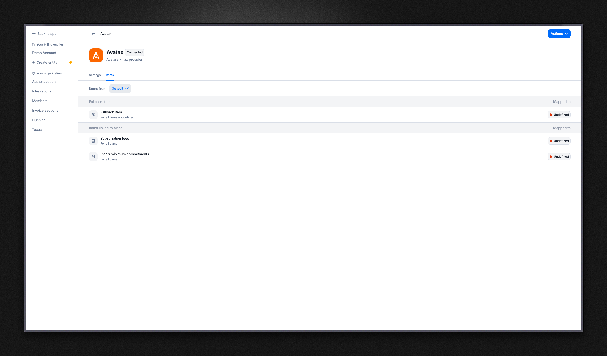
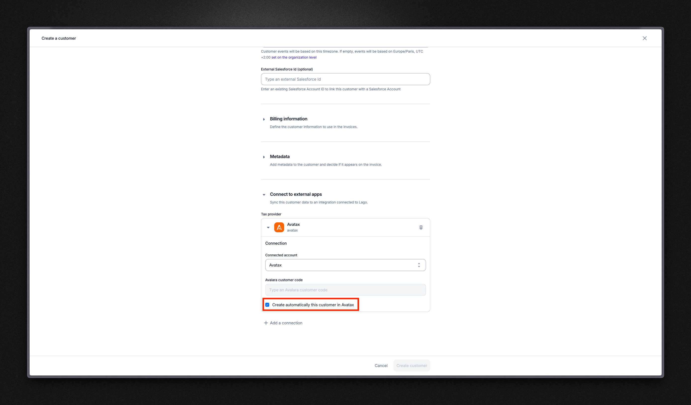
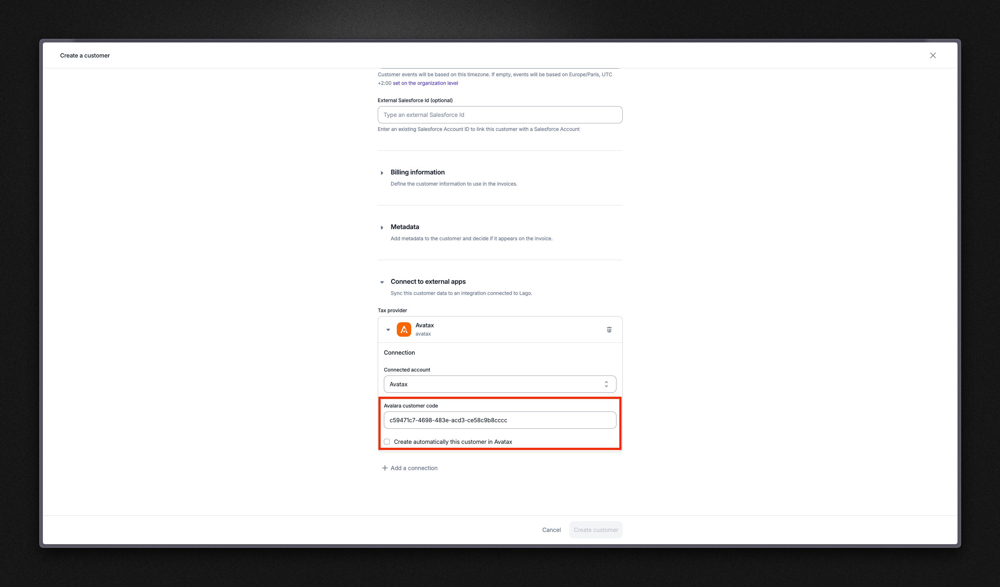
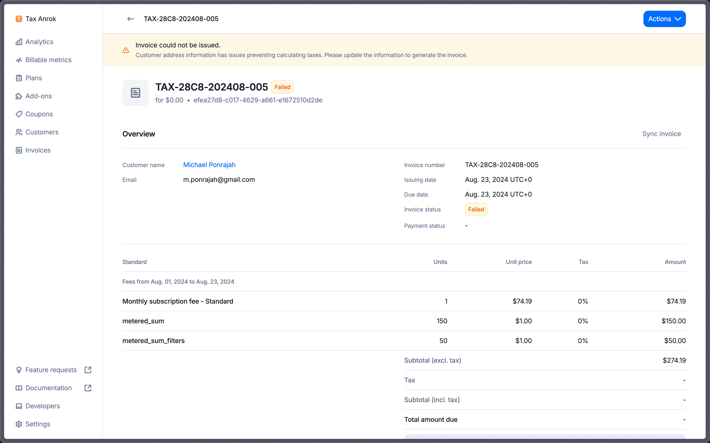
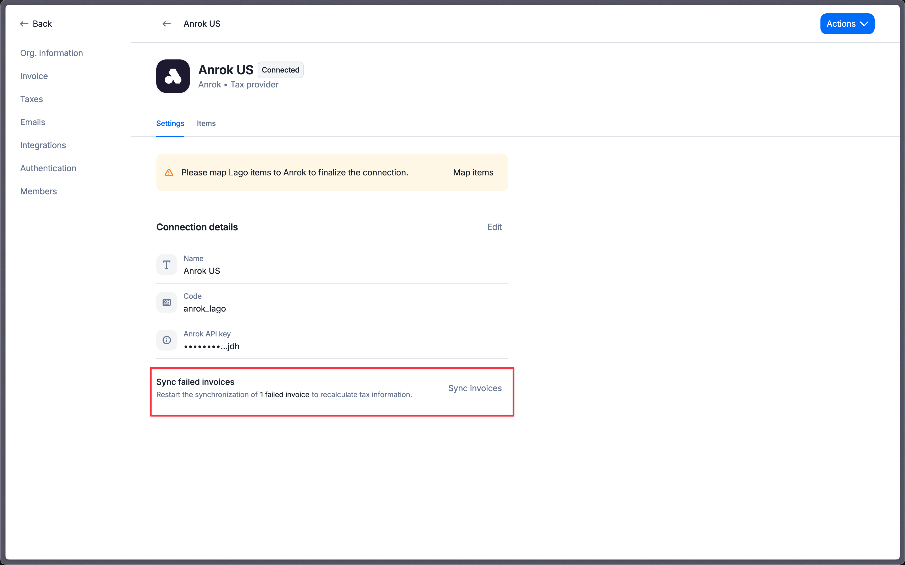

<Info>
**PREMIUM ADD-ON** ✨

This integration is available upon request only. Please **[contact us](mailto:hello@getlago.com)** to get access to this premium feature.
</Info>

<Note>
Contract-level sync details for V2 are not documented yet. Item mapping is documented for legacy v1 objects. How V2 products, rate cards and rates map to Avalara items, and how Avalara taxes apply to V2 contract current usage, is not documented. Check with the Lago team before you rely on Avalara for V2 contract invoices.
</Note>

## Overview

Lago’s native integration with **AvaTax** (by Avalara) calculates, applies and reports tax throughout the invoicing process.

When an invoice is in `draft` status, Lago creates a `SalesOrder` in AvaTax to estimate the applicable taxes. 
This preliminary calculation allows teams to preview tax amounts before finalizing the invoice.

Once the invoice is `finalized` in Lago, a corresponding `SalesInvoice` is created in AvaTax. 
This marks the transaction as final and eligible for reporting to the appropriate tax authorities, ensuring compliance and traceability.

To calculate tax, Lago includes both the `ShipFrom` and `ShipTo` addresses for each invoice. 
AvaTax uses these details to apply tax rules based on the nexus jurisdictions you’ve configured in your Avalara account.

The calculated tax data is returned from AvaTax and automatically applied to the Lago invoice. 

Lago also keeps your records in sync by automatically updating AvaTax whenever an invoice is voided or disputed, or when a credit note is issued. 
This keeps your tax reporting in Avalara up to date.

## Prerequisites

1. **Premium add-on feature**: To access AvaTax via Lago, you must have access to the Premium add-on. If you don’t already have it enabled, please reach out to us for assistance.
2. **Getting Started**: We strongly recommend reviewing the [AvaTax Getting Started Guide](https://developer.avalara.com/documentation/sales-and-use-tax/) to familiarize yourself with the requirements and configuration steps.
3. **Billing entity address**: For accurate tax calculation, Avalara requires a valid ShipFrom address. This corresponds to the billing entity’s account address and must be configured in the Lago dashboard under **Settings > Entity > General information**.
4. **Nexus in Avalara**: Make sure your Avalara account is properly set up with all `nexus` jurisdictions. These are the states or regions where you are obligated to collect and remit sales tax.
5. **Customer exemptions**: If necessary, upload valid exemption certificates for your customers in Avalara. Ensure that when you create a customer profile in Lago, you use the same customer ID as in Avalara. This consistency allows Lago to correctly identify the customer and apply the exemption certificates when calculating taxes.

## Connect AvaTax to Lago

Lago supports connections to multiple AvaTax instances, so you can connect both a sandbox and a production environment.

**To connect an AvaTax instance:**
1. Navigate to **Settings > Integrations** in your Lago dashboard
2. Select **Avalara** from the available integrations
3. Create a unique name and code to identify this connection
4. Enter your Avalara credentials: Account ID, License key and Company code
5. Click **Create** to establish the connection

### Mapping items between Lago and Avalara (mandatory)

To synchronize invoices and retrieve tax data, Lago needs to establish a one-to-one relationship between its objects and Avalara products.
**You can define tax mappings per Lago entity when different entities require distinct Avalara Product IDs**. If the same mapping applies across entities, configure a default mapping. It will be used for any entity that doesn't have a specific override.

Follow these steps to map an item:

1. Navigate to the [Avalara Tax Code search](https://taxcode.avatax.avalara.com/) documentation page.
2. Click on a product and **copy its Tax code.**
3. In Lago, navigate to **Integration** > **Avalara** > **Mapping**.
4. Choose the item you want to associate with the Tax code selected in step 2.
5. **Paste the Tax code to map the item**. Repeat this action for all items in Lago that require mapping.

<Info>
The invoice will be marked as `failed` if any item requiring tax calculation from Avalara is not properly mapped and no fallback item is provided.
</Info>

### Mapping a fallback item (mandatory)
The fallback item serves as a backup and is used if the mapping of other items is not defined. 
This dummy item ensures continuous data synchronization between Lago and Avalara in the event of mapping issues.

<Frame caption="Mapping Lago item to Avalara">
  
</Frame>

## Customer configuration for tax calculation

### Customer synchronization

When creating or updating a Lago customer, you can establish a connection to an existing Avalara customer or automatically create a new one.

**Automatically creating a new Avalara customer**

To create a new customer in Avalara directly from Lago:

1. Create or update a Lago customer;
2. Ensure the customer has a valid address;
3. Verify the customer's state uses valid two or three-character ISO 3166 region codes;
4. Select your target Avalara connection;
5. Check the box labeled "Create this customer automatically in Avalara"; and
6. Save the customer to complete the process.

<Frame caption="Automatically creating a new Avalara customer">
  
</Frame>

**Results:**
- **Success**: A new field appears in the Lago customer information tab with a direct link to the corresponding Avalara customer
- **Failure**: The `customer.tax_provider_error` webhook is triggered to notify you of any issues

**Importing an existing Avalara customer**

To link a Lago customer to an existing Avalara customer:

1. Create or update a Lago customer
2. Select your target Avalara connection
3. Ensure the box labeled "Create this customer automatically in Avalara" is unchecked
4. Enter the existing Avalara customer ID in the designated field
5. Save the customer to complete the import

<Frame caption="Importing an existing Avalara customer">
  
</Frame>

**Results**:
- **Success**: A new field appears in the Lago customer information tab with a direct link to the corresponding Avalara customer
- **Failure**: The `customer.tax_provider_error` webhook is triggered if the sync encounters issues

### Address requirements
Avalara requires that each customer in Lago has a valid shipping address with a valid state following the two or three character **ISO 3166 region codes**.
If a shipping address is not available, Lago will default to using the billing address for tax calculation purposes. 
If both addresses are invalid or missing, Lago will be unable to generate the invoice, and the invoice status will be marked as failed. 
In such cases, you will be notified of the failure in the dashboard and via webhook.

<Frame caption="Invoice marked as failed after a tax error">
  
</Frame>
    

### Customer exemptions
If you need to apply exemptions to a customer, you can upload valid exemption certificates for your customers in Avalara. 
Ensure that when you create a customer profile in Lago, you use the same customer ID as in Avalara. 
This consistency allows Lago to correctly identify the customer and apply the exemption certificates when calculating taxes.

### Tax identifier

If a customer has a `tax_identification_number` configured in Lago, this ID will be sent to Avalara for tax calculation and reporting. This ID is essential for determining whether the transaction is subject to a reverse charge in eligible VAT countries.

### Tax exempt customers

For customers who qualify for tax exemptions, you need to create a Certificate in your Avalara dashboard. Ensure that the customer profile in Lago uses the same customer ID as in Avalara in the Avalara customer ID. This consistency allows Lago to correctly identify the customer and apply the exemption certificates when calculating taxes.

## Error management

### Refresh draft invoice with tax errors

When an invoice is in `draft` and encounters a tax synchronization error, you have the option to refresh the invoice to recalculate the tax. The invoice remains editable during this process, and the error will not prevent the invoice from being `finalized`. If the error persists after attempting to finalize the invoice, the invoice will be marked as `failed`.

### Retry synchronization for failed invoice

When an invoice fails due to a tax synchronization error, you have the option to manually re-sync each invoice individually from the invoice details page or via [`POST /api/v2/invoices/{lago_id}/retry_taxes`](/v2/api-reference/invoices/retry-taxes). Alternatively, you can go to the integration settings and trigger a bulk invoice synchronization.

<Frame caption="Trigger a bulk invoice synchronization">
  
</Frame>

### Retry synchronization for voided / disputed invoices

When an invoice is voided or disputed, Lago will sync this updated record with Avalara to ensure your reports are accurate. If the sync fails, you will be notified via webhook. In that case, please manually resync the voided or disputed invoice through the dashboard.

### Retry synchronization for credit notes

When a credit note is created, Lago will sync this record with Avalara to ensure your reports are accurate. If the sync fails, you will be notified via webhook. In that case, please manually resync the credit note through the dashboard.

### Tax error scenario

If Lago is unable to generate an invoice or sync it to Avalara, you will be alerted via the dashboard and webhook.
Tax synchronization and invoice generation can fail due to the following reasons:

1. Incorrect connection settings (API key).
2. Items used in objects or fallback items not mapped.
3. Missing customer shipping or billing address.
4. Timeout or internal service error.

Tax synchronization can fail during the following processes:

1. Refreshing a draft invoice
2. Finalizing an invoice
3. Voiding an invoice
4. Disputing an invoice
5. Creating a credit note

If an issue arises, please check the mapping, verify the customer address and launch a synchronization; or contact the Lago team for assistance.