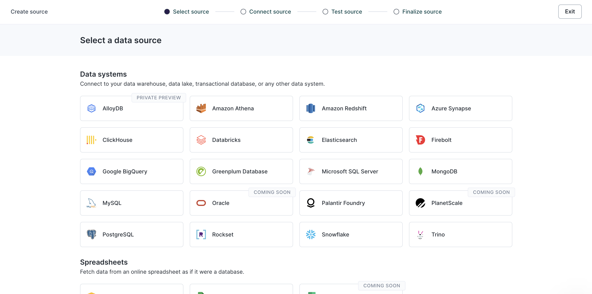
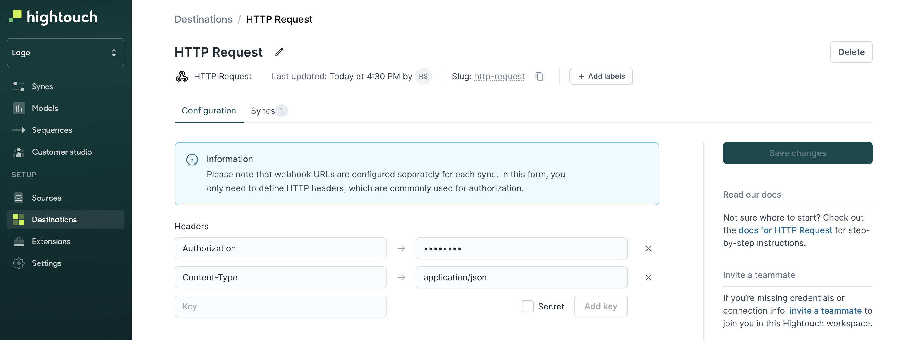
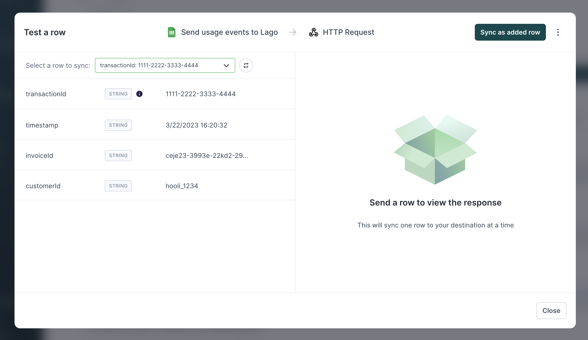

The Hightouch integration syncs usage rows from your warehouse, database or spreadsheet to Lago as billable events. Use it when usage already lives in a data source and you want Lago to rate it against a contract.

## Prerequisites

**In Lago:**
1. Create a Lago organization to manage your billing and invoicing.
2. Create a [billable metric](/v2/guide/billable-metrics/create-billable-metrics) to track the usage of your customers.
3. Create a [metered product](/v2/guide/product-catalog/metered-products) on that metric, price it with a [rate card](/v2/guide/rate-cards/overview), and add it to a [plan](/v2/guide/plans/overview).
4. Create a [customer](/v2/guide/customers/customer-management) and a [contract](/v2/guide/contracts/overview) for that customer.

**In Hightouch:**
1. Create a Hightouch account.
2. Create a data source (ideally, product usage of your customer).
3. Create an **HTTP Request** destination.

## Send usage from Hightouch to Lago

### Create a data source

First, create a source in Hightouch:
1. Navigate to the **Sources** tab.
2. Add a **new source**.
3. Choose and set up a data source available in Hightouch (a database, a warehouse or a spreadsheet, for instance).

<Frame caption="Hightouch Sources">
  
</Frame>

### Use the HTTP Request destination

Lago uses Hightouch's HTTP Request destination to ingest usage:
1. Go to the **Destinations** tab.
2. Select the **HTTP Request** destination.
3. Define your **Headers**. Lago requires `Authorization` (secret, `Bearer __YOUR_API_KEY__`) and `Content-Type: application/json`.
4. Save the destination.

<Frame caption="Hightouch HTTP Request Destination">
  
</Frame>

### Create a sync

Go to the **Syncs** tab and create a new sync from your source to the HTTP Request destination.

1. Configure when to trigger the event (row added, row deleted, row updated).
2. Define `POST` as the HTTP method.
3. Define the target URL: `https://api.getlago.com/api/v2/events` (or `https://api.eu.getlago.com/api/v2/events` for EU-hosted organizations).
4. Send data as `JSON` and use the JSON editor.
5. Define rate limits, if applicable.

### Example JSON payload

You define the JSON payload sent to Lago. Hightouch supports the Liquid template language to insert variables from your source: `"{{ row.variable }}"`, where *variable* is the column name in your source.

The payload follows the events schema of [`POST /api/v2/events`](/v2/api-reference/events/create). Each event targets a contract through `external_contract_id`:

```json
{
  "event": {
    "transaction_id": "{{ row.transactionId }}",
    "external_contract_id": "{{ row.contractId }}",
    "code": "api_calls",
    "timestamp": "{{ row.timestamp }}",
    "properties": {
      "invoice_id": "{{ row.invoiceId }}"
    }
  }
}
```

<Info>
`transaction_id` and `code` are required. `code` must match a billable metric code. `external_contract_id` must match the `external_id` of the contract you bill. `timestamp` is a Unix timestamp in seconds and defaults to the request time. Adapt `properties` to your billable metric.
</Info>

### Test and activate your sync

Test the sync with a data sample. The event should appear in Lago's events list, or through [`GET /api/v2/events`](/v2/api-reference/events/list). Once ready, activate the sync and define the periodic trigger.

<Frame caption="Hightouch Test Sync with Lago">
  
</Frame>

## Hightouch to Lago demo video

<Note>
This video was recorded with the legacy v1 events payload. Its Hightouch setup steps still apply. Use the V2 URL and payload above.
</Note>

<iframe width="700" height="500" src="https://www.youtube.com/embed/2NBmQYjrz40" title="Hightouch to Lago demo video" frameborder="0" allow="accelerometer; autoplay; clipboard-write; encrypted-media; gyroscope; picture-in-picture; web-share" allowfullscreen></iframe>

<CardGroup cols={2}>
  <Card title="Ingest usage" icon="bolt" href="/v2/guide/events/ingesting-usage">
    How events target a contract.
  </Card>
  <Card title="Ingest a batch of events" icon="code" href="/v2/api-reference/events/batch">
    `POST /api/v2/events/batch` reference.
  </Card>
</CardGroup>
