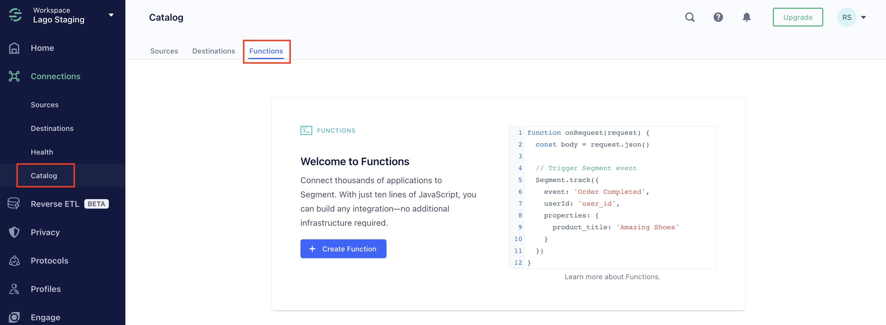
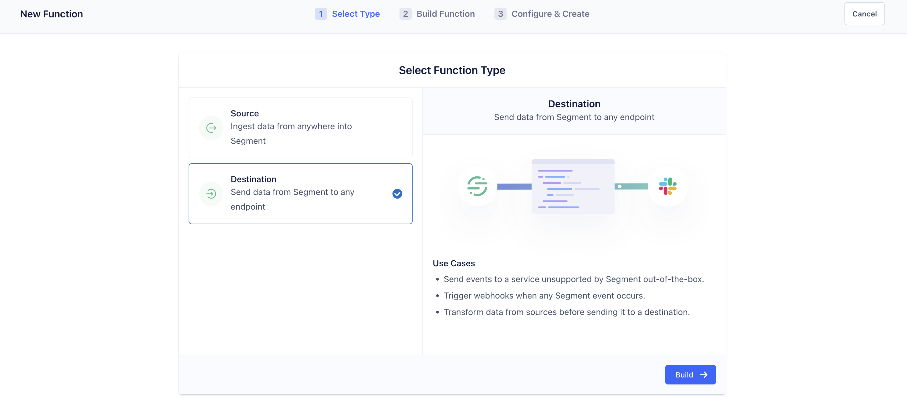
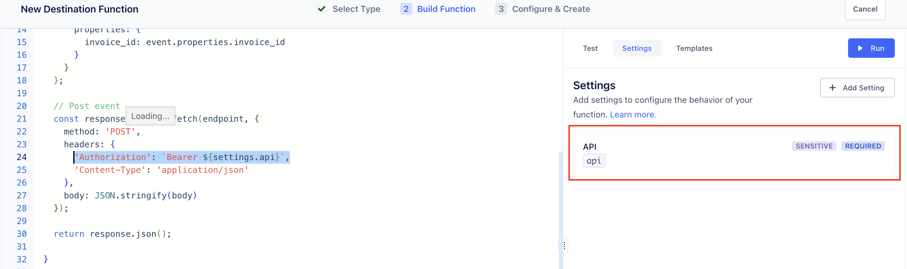

The Segment integration forwards product usage tracked in Segment to Lago as billable events. Use it when Segment already captures the actions you bill on and you want Lago to rate them against a contract.

## Prerequisites

**In Lago:**
1. Create a Lago organization to manage your billing and invoicing.
2. Create a [billable metric](/v2/guide/billable-metrics/create-billable-metrics) to track the usage of your customers.
3. Create a [metered product](/v2/guide/product-catalog/metered-products) on that metric, price it with a [rate card](/v2/guide/rate-cards/overview), and add it to a [plan](/v2/guide/plans/overview).
4. Create a [customer](/v2/guide/customers/customer-management) and a [contract](/v2/guide/contracts/overview) for that customer.

**In Segment:**
1. Create a Segment account.
2. Create a data source (ideally, product usage of your customer).

## Send usage from Segment to Lago

### Create a function

Create a custom **Function** in Segment:
1. Navigate to the **Catalog** in Segment.
2. Click the **Functions** tab to access the custom Functions feature.
3. Choose to create your first function and follow the prompts to set it up.

<Frame caption="Segment Functions">
  
</Frame>

### Use the destination function

Select the **Destination function**, as you want to send data from Segment to Lago.

<Frame caption="Destinations function">
  
</Frame>

### Post requests to Lago events

Replace the pre-written code in the editor with the function below. It catches a **Track** event from Segment, builds a Lago event body and posts it to [`POST /api/v2/events`](/v2/api-reference/events/create). Each event targets a contract through `external_contract_id`.

```javascript
// Runs every time a Track call is made on Segment
async function onTrack(event, settings) {

  // Lago events endpoint
  const endpoint = 'https://api.getlago.com/api/v2/events';

  // Event body following the Lago events schema
  const body = {
    event: {
      transaction_id: event.messageId,
      // map this to the external_id of the Lago contract being metered
      external_contract_id: event.properties.contract_id,
      code: event.event,
      timestamp: Math.floor(new Date(event.timestamp).getTime() / 1000),
      properties: {
        invoice_id: event.properties.invoice_id
      }
    }
  };

  // Post event
  const response = await fetch(endpoint, {
    method: 'POST',
    headers: {
      'Authorization': `Bearer ${settings.api}`,
      'Content-Type': 'application/json'
    },
    body: JSON.stringify(body)
  });

  return response.json();
}
```

<Info>
`transaction_id` and `code` are required. `code` must match the code of a billable metric. `external_contract_id` must match the `external_id` of the contract you bill. The example reads it from a `contract_id` property on the Segment event. Map it from wherever your tracking plan stores it. For EU-hosted organizations, use `https://api.eu.getlago.com/api/v2/events`.
</Info>

<Info>
This function can be adapted to Identify, Group or Page events. Refer to [Segment's documentation](https://segment.com/docs/connections/functions/destination-functions/) for all available actions. The `properties` object depends on your billable metric. Add or remove properties, and add conditions to send only specific events to Lago.
</Info>

### Use the test mode editor

Use a sample event in the **Test** panel to preview the data fetched from a Segment event and debug the function before you deploy it.

### Hide sensitive data

The function reads the **API key** from a setting instead of hard-coding it. Store it as a sensitive variable.

To create **Settings** variables:
1. Go to the **Settings** tab.
2. **Add** a new Setting.
3. Define a **Name** and a **Label** for this Setting.
4. Define it as **Required** or **Optional**.
5. Mark it as **Sensitive**.

<Frame caption="Hide sensitive data with settings variables">
  
</Frame>

### Send usage events to Lago

Run the function in Segment to send a test event to Lago. Check it in the events list or with [`GET /api/v2/events`](/v2/api-reference/events/list). Once the setup is finalized in Segment, the function triggers automatically on your defined behavior.

## Segment to Lago demo video

<Note>
This video was recorded with the legacy v1 events payload. Its Segment setup steps still apply. Use the V2 code above for the endpoint and the contract identifier.
</Note>

<iframe width="700" height="500" src="https://www.youtube.com/embed/lyJmdh47JTE" title="Segment to Lago demo video" frameborder="0" allow="accelerometer; autoplay; clipboard-write; encrypted-media; gyroscope; picture-in-picture; web-share" allowfullscreen></iframe>

<CardGroup cols={2}>
  <Card title="Ingest usage" icon="bolt" href="/v2/guide/events/ingesting-usage">
    How events target a contract.
  </Card>
  <Card title="Ingest an event" icon="code" href="/v2/api-reference/events/create">
    `POST /api/v2/events` reference.
  </Card>
</CardGroup>
